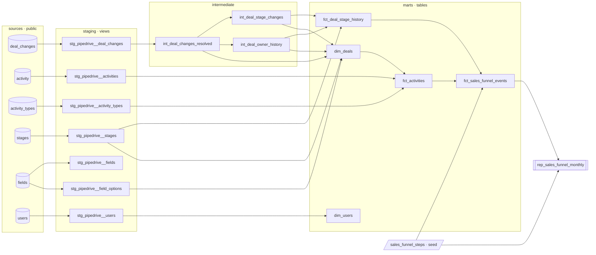

# Enpal – Pipedrive sales funnel (dbt)

A dbt project that turns a raw Pipedrive CRM extract into **reusable deal and activity data layers**
and, on top of them, the monthly funnel report **`rep_sales_funnel_monthly`**
(`month`, `kpi_name`, `funnel_step`, `deals_count`).

**Contents**
1. [Quick start](#1-quick-start)
2. [Architecture](#2-architecture)
3. [Exploratory analysis – what the data really says](#3-exploratory-analysis--what-the-data-really-says)
4. [Modelling decisions & KPI definitions](#4-modelling-decisions--kpi-definitions)
5. [Data quality & testing](#5-data-quality--testing)
6. [SQL efficiency](#6-sql-efficiency)
7. [Result](#7-result)
8. [Limitations & next steps](#8-limitations--next-steps)

---

## 1. Quick start

```bash
docker compose up -d                       # Postgres on localhost:5432 + CSV loader
python -m venv .venv                       # tested with Python 3.12
source .venv/Scripts/activate              # Windows Git Bash; PowerShell: .venv\Scripts\Activate.ps1; macOS/Linux: source .venv/bin/activate
pip install -r requirements.txt            # dbt-core 1.11 + dbt-postgres 1.11 (versions it was tested with)
dbt deps                                   # installs dbt_utils
dbt build                                  # 1 seed + 16 models + 131 data tests
dbt docs generate && dbt docs serve        # optional: browsable lineage & column docs
```

The `data_loader` container loads the six CSVs and exits after a few seconds. Run `dbt build` once
`docker compose logs data_loader` ends with `Data loading completed.`
The loader runs again whenever the stack is started again (a second `docker compose up`, or starting the
project in Docker Desktop), so `raw_data/load_data.sh` was changed from the template to be repeatable. Each table is truncated and reloaded in one transaction, so a re-run replaces the
data instead of appending duplicates. A failed load stops the loader with an error instead of reporting
success.

`profiles.yml` lives in the project root and defaults to the docker credentials
(override with `DBT_HOST`, `DBT_PORT`, `DBT_USER`, `DBT_PASSWORD`, `DBT_DATABASE`).

## 2. Architecture



| Layer | Folder | Materialization | Schema | Responsibility |
|---|---|---|---|---|
| Sources | `models/staging/pipedrive/_pipedrive__sources.yml` | – | `public` | Declares the 6 raw tables, with source-level tests. |
| Staging | `models/staging/pipedrive` | view | `public_pipedrive_staging` | 1:1 with sources: rename, cast, surrogate keys, unnest JSON. No joins, no business logic. |
| Intermediate | `models/intermediate` | view (one table) | `public_pipedrive_intermediate` | Reusable transformations of the change log: deal-id resolution, stage timeline, owner validity intervals. Not meant for BI. |
| Marts | `models/marts/core`, `models/marts/sales` | table | `public_pipedrive_analytics` | Consumer-facing dimensions and facts at clear grains. |
| Reporting | `models/reporting` | table, enforced contract | `public_pipedrive_analytics` | KPI/report models built **only** on marts and seeds. |

**Marts – built to serve more than this one report**

| Model | Grain | Typical questions it answers |
|---|---|---|
| `dim_deals` | 1 row per deal | Current stage, furthest stage reached, owner, status, lost reason, created/lost dates, skip counts. |
| `fct_deal_stage_history` | 1 row per stage entry (SCD2: `entered_at`/`exited_at`) | Stage-to-stage conversion, time between stage changes, skip rates, funnel by owner at entry time. |
| `fct_activities` | 1 row per activity | Activity volumes, completion rates, rep activity, sales-call KPIs. |
| `dim_users` | 1 row per user | Owner / assignee names (email intentionally kept out of marts). |
| `fct_sales_funnel_events` | 1 row per deal × funnel step | When each deal first entered each step: monthly funnels for all steps; cohort conversion and time between steps for the stage steps 1–9 (sales calls cannot be linked to deals, finding 3). |
| `rep_sales_funnel_monthly` | 1 row per month × funnel step | The requested report. |

**Conventions.** Prefixes encode the layer (`stg_<source>__<entity>`, `int_`, `dim_`, `fct_`, `rep_`).
Every model has a primary key tested with `unique` + `not_null`; the report and
`stg_pipedrive__field_options` use a tested unique column combination instead. Every model, seed and
source column has a description. One models YAML per folder (staging also has the sources YAML), and
column definitions shared across models live in `models/_docs.md` (doc blocks). The funnel definition
is data, in `seeds/sales_funnel_steps.csv`, not `CASE` logic in SQL.

## 3. Exploratory analysis – what the data really says

All queries are reproducible in [`analyses/`](analyses) (they compile against the dbt sources:
`dbt compile --select path:analyses`).

**The shape of the data**
- `deal_changes` is an **entity-attribute-value change log**: 15,406 rows and 1,995 deal ids, tracking
  only four fields: `add_time` (2,000), `stage_id` (8,906), `user_id` (2,500) and `lost_reason` (2,000).
  The current state of a deal is stored nowhere. It has to be derived, which is why `dim_deals` exists.
- There is one pipeline with 9 linearly ordered stages. Every deal enters at stage 1.
- Deals were created between 2024-01-01 and 2024-09-13. Their stage and loss events run until March 2025.
  The extract is therefore a **cohort of deals**: the months after Sep 2024 only show these deals moving
  on, not a real collapse in demand.
- Activities are due in the same window, 2024-01-01 to 2024-09-13, and the activity extract ends there.
  For the sales-call steps, Sep 2024 covers only 13 days, and from Oct 2024 there are no activity
  records at all. Zeros there mean "not in the extract", not "no calls happened".

**Findings that change the numbers**

| # | Finding | Evidence | How it is handled |
|---|---|---|---|
| 1 | **5 deal ids are reused by two different deals.** | Two `add_time` events per id, with interleaved histories (e.g. stages 1→2→3→4, then 1→2 again while the first deal moves on to 5 and 8). Every backward or repeated stage move, and every stage change after a loss, sits in these 5 ids. In this extract every change is logged at its creation's time of day: 0 mismatches over 15,326 rows of normal deals, and each of the 80 rows of the reused ids matches exactly one of its two creations. | `int_deal_changes_resolved` splits them deterministically into `deal_key`s (`399956-1`, `399956-2`). The time-of-day rule is applied **only** to reused ids and is guarded by tests (no row lost, no fan-out, every row resolved). 2,000 deals result. Root cause to escalate upstream: Pipedrive ids are primary keys. |
| 2 | **Stages are skipped a lot.** | 36% of stage moves jump over ≥1 stage (e.g. 1→3: 329 times). Observed entries into stage 2 = 1,483, but 1,995 deals got past stage 1. | Funnel steps count **observed entries** (a deal that skipped stage 2 did not enter it). `dim_deals.max_stage_id` allows a cumulative "reached" funnel without remodelling (table below). |
| 3 | **Activities and deals are two separate populations.** | Only 8 of 4,572 activity `deal_id`s exist in `deal_changes`, which is consistent with chance. Both id sets are 6-digit numbers spread over 100000–999999, so about 10 matches (4,572 × 1,995 / 900,000) would occur at random. The 8 matches do not look like real links either: 4 of their activities are due before the deal was created (e.g. Sales Call 2 `592431` is due 2024-04-19 on deal `984965`, created 2024-08-29). Activity assignees never match the deal owner. In Jan 2024, 77 deals had a Sales Call 1 while only 30 entered the pipeline. | Sales-call steps (2.1, 3.1) are counted from activities on their own. An inner join to deals would wipe them out. Without a link, sales calls support monthly counts only: no cohorts, no conversion to or from stage steps, no time between steps. `fct_activities.deal_key` and `has_deal_history` record an id match, not a verified link. A `relationships` test warns about the gap. |
| 4 | **`activity_id` is not unique.** | 11 ids are reused by unrelated activities (different deal, type, user and date). | Surrogate `activity_key`. The `unique(activity_id)` test is a warning. |
| 5 | **No deal is recorded as won; every deal ends with a lost reason.** | `lost_reason` is set exactly once per deal, 1–30 days after its last stage change. That includes the 1,083 deals that reached the post-sale stages (7 *Implementation/Onboarding* or later), 325 of them up to *Renewal/Expansion*. There is no `status` or `won_time` field, so the extract cannot show whether a deal was won before it was marked lost. | `deal_status` is `lost`/`open`, derived from `lost_reason` only. "Won" is not invented. Reaching stages 7–9 suggests many of these deals did become customers, so `lost` should not be read as "never won". |
| 6 | **Step 1 timing ≠ deal creation.** | Stage 1 is entered 2–83 days (median 35) after `add_time`. | Step 1 = entry into stage 1, consistent with steps 2–9. `dim_deals.created_at` keeps the creation date for "deals created" KPIs. |
| 7 | Lookup inconsistencies | `stages` says *Qualified lead*, `fields` says *Qualified Lead*. *Follow Up Call* is an inactive type with 1,133 historical activities. | KPI names are owned by the seed. `is_activity_type_active` is exposed. |
| 8 | Activities have no completion timestamp | Only `due_to` plus a `done` flag (~50% done). | Sales calls count when `done = true`, timed at `due_to` (the best available proxy). |

Other checks that passed: no nulls in any key column, no exact duplicates, all owner and assignee
users exist, all `changed_field_key`s are documented in `fields`, owner always assigned before the
first stage entry, `add_time.new_value` always equals `change_time`.

**Observed entries vs. cumulative "reached"** (all months, after deal-id resolution):

| Stage | Entered (report) | Reached (max stage ≥ N) | Lost in this stage |
|---|---:|---:|---:|
| 1 Lead Generation | 2,000 | 2,000 | 5 |
| 2 Qualified Lead | 1,483 | 1,995 | 39 |
| 3 Needs Assessment | 1,308 | 1,956 | 89 |
| 4 Proposal/Quote Preparation | 1,087 | 1,867 | 170 |
| 5 Negotiation | 895 | 1,697 | 270 |
| 6 Closing | 741 | 1,427 | 344 |
| 7 Implementation/Onboarding | 588 | 1,083 | 358 |
| 8 Follow-up/Customer Success | 479 | 725 | 400 |
| 9 Renewal/Expansion | 325 | 325 | 325 |

## 4. Modelling decisions & KPI definitions

**Deal identity.** `deal_key` is the deal identifier in all marts (finding 1). `deal_id` stays available
for lookups in Pipedrive.

**"A deal entered funnel step X in month M"** (`fct_sales_funnel_events` → `rep_sales_funnel_monthly`):

| Step | KPI | Source event (seed `sales_funnel_steps`) | Rule |
|---|---|---|---|
| 1–9 | Pipeline stages | `stage_id` change into stage 1–9 | **First** entry of the deal into the stage. Re-entries do not count again. Month = month of that entry. |
| 2.1 | Sales Call 1 | activity type `meeting` | **First completed** (`done`) activity of that type per activity `deal_id`. Month = month of `due_to`. |
| 3.1 | Sales Call 2 | activity type `sc_2` | Same as 2.1. |

- **Flow, not cohort.** A month shows how many deals entered the step in that month, whenever they were
  created. For the stage steps 1–9, cohort views (by creation month) come from `fct_sales_funnel_events`
  joined to `dim_deals` on `deal_key`. The sales-call steps 2.1 and 3.1 cannot be joined to deals
  (finding 3), so they support monthly counts only.
- **Time in stage = time until the next stage change.** `fct_deal_stage_history.days_in_stage` is null
  for each deal's last stage. In this extract that is always the stage the deal was lost from, so
  averages of `days_in_stage` cover stage-to-stage transitions only. The time from the last stage to the
  loss is `dim_deals.lost_at - current_stage_entered_at` (1–30 days for every deal).
- **Dense output.** Every month × step from the first to the last funnel event, zero-filled. Charts and
  month-over-month deltas never miss rows.
- **`funnel_step` is numeric** (1, 2, 2.1, 3, 3.1, …), so it sorts in funnel order; `kpi_name` carries the label.
- **Funnel changes are data changes.** Renaming a KPI, remapping a step to another stage or activity type,
  or adding a step means editing the seed. The report SQL has no hard-coded stage ids.
- **Clients = deals.** The extract has no person or organization entities, so a deal stands in for a client.

## 5. Data quality & testing

`dbt build` runs **131 data tests** (26 of them on the raw sources). Severity is deliberate:

- **Errors**: anything that would make a number wrong. Primary keys on every model (`unique`/`not_null`),
  grain tests (`unique_combination_of_columns`), referential integrity, `accepted_values`, the funnel seed's
  "exactly one source event per step" rule, and the enforced contract on the report.
- **Warnings**: source defects that are surfaced, not hidden. Two fire today, as expected: reused
  `activity_id`s (11) and activity deal ids missing from the change log (4,571 rows). Two are guards that
  stay silent today: a field other than the four known ones appearing in `deal_changes`
  (`accepted_values` on `changed_field_key`), and backward or repeated stage moves (singular test below).
- **Singular tests** (`tests/`):
  - `assert_rep_sales_funnel_monthly_reconciles`: end-to-end check at the report's grain. The full report
    (every month × step, including the zero rows) is rebuilt independently from the resolved change log
    and the staged activities, then compared row by row. A wrong count, an entry booked in the wrong
    month, a missing row or an unexpected extra row all fail the test.
  - `assert_deal_changes_resolution_is_lossless`: deal-id resolution keeps the row count identical.
  - `assert_deal_stages_only_move_forward` (warn): alerts if backward or repeated moves appear after resolution.

PII: `users.email` is tagged `contains_pii` and stays in staging. Marts expose only the user name.

## 6. SQL efficiency

- **Single scans, no self-joins.** The change log is pivoted with `FILTER`-ed aggregates in one `GROUP BY`
  (`dim_deals`), and latest values come from `DISTINCT ON`. Timelines use window functions instead of
  correlated subqueries.
- **Shared windows.** Window functions over the same partition and order share one named `WINDOW`
  (`deal_timeline` in `int_deal_stage_changes` and `int_deal_owner_history`), so they can be computed over
  a single sort. Only `is_first_entry_to_stage` needs a second window, partitioned by `(deal_key, stage_id)`.
- **Filter early, project explicitly.** Each field-specific model filters `field_key` before casting
  `new_value`. No `select *` beyond the source boundary.
- **No unnecessary `DISTINCT`.** The funnel fact is tested unique per (deal, step), so the report uses
  `count(*)` instead of `count(distinct …)`.
- **Materialize once, reuse many.** Staging stays as cheap views. `int_deal_changes_resolved` is a table
  because every deal-level model reads it. Marts are tables with Postgres indexes on their keys and main
  filters (`deal_key`, `deal_id`, `(stage_id, entered_at)`, `(funnel_step, entered_month)`).
- **Month spine.** It uses `generate_series` over the observed min/max month, with no calendar table to maintain.
- `threads: 4` lets independent branches of the DAG build in parallel.

## 7. Result

`public_pipedrive_analytics.rep_sales_funnel_monthly`: 154 rows (14 months × 11 steps). Pivoted preview
of `deals_count`:

| month | 1 | 2 | 2.1 | 3 | 3.1 | 4 | 5 | 6 | 7 | 8 | 9 |
|---|---:|---:|---:|---:|---:|---:|---:|---:|---:|---:|---:|
| 2024-01 | 30 | 6 | 77 | 0 | 67 | 1 | 0 | 0 | 0 | 0 | 0 |
| 2024-02 | 194 | 74 | 64 | 27 | 59 | 17 | 10 | 8 | 1 | 0 | 2 |
| 2024-03 | 199 | 157 | 54 | 142 | 75 | 75 | 51 | 28 | 21 | 12 | 7 |
| 2024-04 | 230 | 153 | 71 | 131 | 58 | 100 | 85 | 72 | 43 | 33 | 23 |
| 2024-05 | 248 | 178 | 61 | 149 | 65 | 122 | 97 | 84 | 49 | 59 | 25 |
| 2024-06 | 244 | 178 | 64 | 168 | 66 | 138 | 114 | 89 | 70 | 65 | 42 |
| 2024-07 | 267 | 190 | 88 | 168 | 65 | 127 | 96 | 95 | 91 | 55 | 48 |
| 2024-08 | 240 | 191 | 57 | 175 | 72 | 156 | 104 | 99 | 74 | 74 | 37 |
| 2024-09 | 210 | 175 | 32 | 128 | 33 | 131 | 131 | 78 | 70 | 51 | 43 |
| 2024-10 | 120 | 129 | 0 | 138 | 0 | 118 | 110 | 84 | 79 | 52 | 37 |
| 2024-11 | 18 | 49 | 0 | 67 | 0 | 72 | 64 | 60 | 50 | 46 | 31 |
| 2024-12 | 0 | 3 | 0 | 14 | 0 | 28 | 28 | 34 | 29 | 20 | 19 |
| 2025-01 | 0 | 0 | 0 | 1 | 0 | 2 | 5 | 10 | 9 | 10 | 10 |
| 2025-02 | 0 | 0 | 0 | 0 | 0 | 0 | 0 | 0 | 2 | 2 | 1 |
| **Total** | **2,000** | **1,483** | **568** | **1,308** | **560** | **1,087** | **895** | **741** | **588** | **479** | **325** |

Reading notes:
- Steps 2.1 / 3.1 come from a different set of deals (finding 3), so they are not a subset of steps 2 / 3.
- Stage steps: the decline from Oct 2024 is this cohort of deals working through the pipeline (no deal was
  created after 2024-09-13), not a business trend.
- Sales-call steps: the activity extract ends on 2024-09-13. Sep 2024 is a partial month (13 days: 32 and
  33 deals vs. 57 and 72 in Aug), and the zeros from Oct 2024 mean no activity records, not no calls.

## 8. Limitations & next steps

- **Upstream fixes:** report the reused deal and activity ids and the activity↔deal mismatch to the CRM
  or integration owner. Once fixed, `int_deal_changes_resolved` becomes a pass-through and the warnings go quiet.
- **Won deals and deal value** need Pipedrive's `status`, `won_time` and `value` fields in the change log.
  `dim_deals` is the single place to add them.
- **Scale:** `deal_changes` is append-only, so `int_deal_changes_resolved` and `fct_deal_stage_history` can
  become incremental models that reprocess only deals with new changes (window functions are per-deal).
  Add a load timestamp to enable `dbt source freshness`.
- **Governance:** separate staging/intermediate schemas are already in place. In production, grant BI access
  to `public_pipedrive_analytics` only, run `dbt build --select state:modified+` in CI, and register
  dashboards as dbt exposures.
- **Assumptions:** timestamps are UTC. `due_to` stands in for when a completed call happened.
